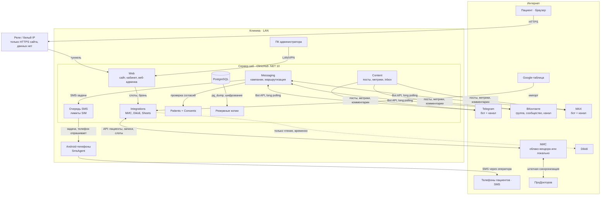
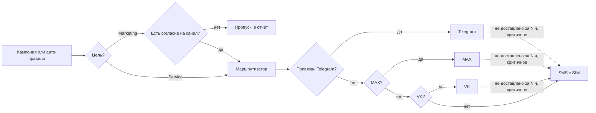

# Схема модулей и интеграций

Рисованная версия со всеми подписями лежит в `system.html` (артефакт в claude.ai). Ниже то же самое в Mermaid: GitHub рендерит его прямо в браузере.

## Маршрут личного сообщения

